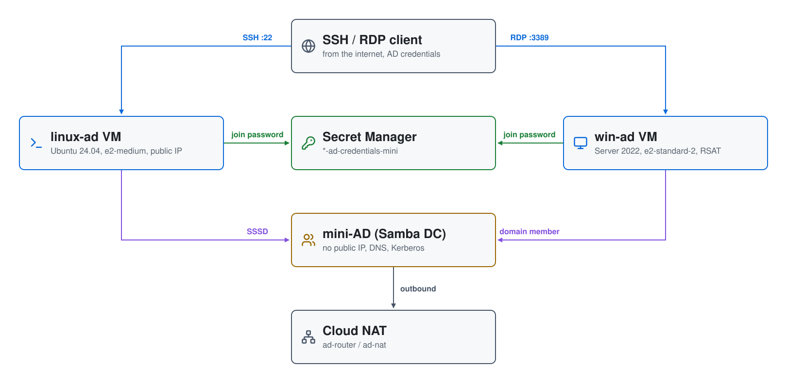
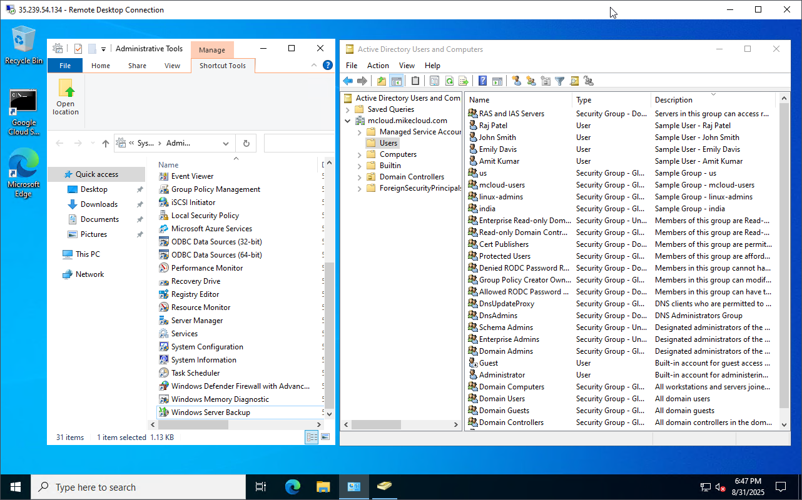
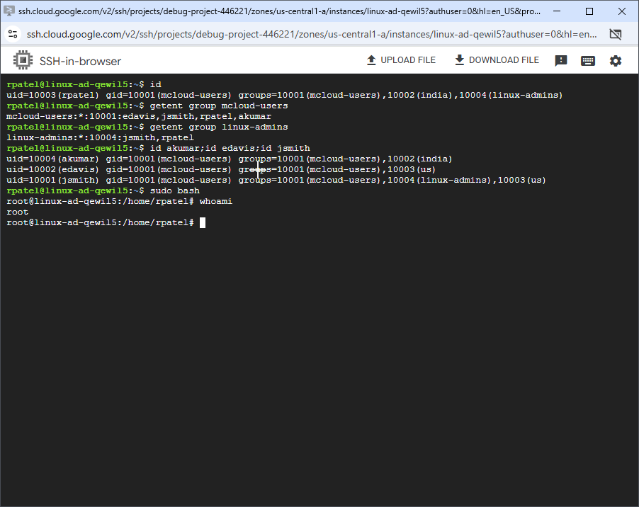

# Mini Active Directory on GCP

A small, fast, low-cost **Active Directory** domain for labs: a **Samba 4**
domain controller on one Compute Engine VM, built much more quickly than
Managed Service for Microsoft Active Directory, with a Linux and a Windows VM
that join the domain at boot. It's the follow-up to our Google Cloud Managed
Microsoft AD project, and the base that the other GCP mini-AD projects build
on. Not for production.

| Piece | Where | Role |
|---|---|---|
| **mini-AD** (Samba DC) | `mini-ad-subnet` (10.1.0.0/24), no public IP | domain `mcloud.mikecloud.com` / `MCLOUD`: users, groups, POSIX IDs, DNS, Kerberos; built by [`module-gcp-mini-ad`](https://github.com/mamonaco1973/module-gcp-mini-ad) |
| **linux-ad VM** | `mini-ad-subnet`, public IP | Ubuntu 24.04, `e2-medium`; joins with `realm` and SSSD; SSH with AD passwords |
| **win-ad VM** | `mini-ad-subnet`, public IP | Windows Server 2022, `e2-standard-2`; joins the domain; RSAT for managing users |
| **Secret Manager** | global | `admin-ad-credentials-mini` and `<user>-ad-credentials-mini` |
| **Cloud NAT** | `us-central1` | outbound internet for the DC |

## Architecture

<picture>
  <source media="(prefers-color-scheme: dark)" srcset="architecture-dark.svg">
  
</picture>

Regenerate with `python3 make_diagram.py`.

- **`01-directory/`**: the VPC (`mini-ad-vpc`) with `mini-ad-subnet`, Cloud
  Router and Cloud NAT, the AD passwords in Secret Manager, and the DC, with
  users and POSIX attributes from `scripts/users.json.template`.
- **`02-servers/`**: the Linux and Windows VMs and their firewall rules.

## How the members join

1. **Linux** (`ad_join.sh`, a startup script): installs SSSD and realmd,
   reads `admin-ad-credentials-mini` from Secret Manager, and joins with
   `realm join`. SSSD is set for short names and the POSIX IDs stored in AD;
   SSH accepts passwords; home directories are created on first login;
   `linux-admins` get passwordless sudo.
2. **Windows** (`ad_join.ps1`, a Windows startup script): skips itself if
   the VM is already joined; otherwise installs RSAT, reads the same secret,
   joins with `Add-Computer`, adds `MCLOUD\mcloud-users` to Remote Desktop
   Users, and reboots.

| User | Groups | sudo on Linux |
|---|---|---|
| jsmith | mcloud-users, us, linux-admins, Domain Admins | yes |
| edavis | mcloud-users, us | no |
| rpatel | mcloud-users, india, linux-admins, Domain Admins | yes |
| akumar | mcloud-users, india | no |

| Group | gidNumber |
|---|---|
| mcloud-users | 10001 |
| us | 10002 |
| india | 10003 |
| linux-admins | 10004 |

## What mini-AD doesn't do

Compared with Managed Service for Microsoft AD, a single Samba DC on a VM
gives up:

- **Operations**: no second DC or multi-region domain, no automatic backups
  or patching, no Google-managed hardening, support, or Cloud Monitoring
  integration.
- **Features**: limited GPO support without replication; no AD Web Services,
  so many AD PowerShell cmdlets don't work; trusts with an on-premises AD
  need manual setup.

## Firewall rules

```
internet ─22──▶ linux-ad VM
internet ─3389─▶ win-ad VM
```

| Rule | Port | Applies to |
|---|---|---|
| `allow-ssh` | tcp 22 | tag `allow-ssh` (linux-ad VM) |
| `allow-rdp` | tcp 3389 | tag `allow-rdp` (win-ad VM) |

Both allow `0.0.0.0/0`; every login still needs an AD account. The DC has no
public IP.

## Prerequisites

* [A Google Cloud Account](https://console.cloud.google.com/)
* [Install gcloud CLI](https://cloud.google.com/sdk/docs/install)
* [Install Terraform](https://developer.hashicorp.com/terraform/install)
* [Install jq](https://jqlang.github.io/jq/download/)

Put a service account key in the repository root as `credentials.json`;
`check_env.sh` activates it, and `api_setup.sh` enables the APIs the build
needs. If this is your first time watching our content, we recommend
starting with this video:
[GCP + Terraform: Easy Setup](https://youtu.be/3spJpYX4f7I).

## Deploy

```bash
git clone https://github.com/mamonaco1973/gcp-mini-ad.git
cd gcp-mini-ad
./apply.sh       # 1: VPC + Cloud NAT + mini-AD + secrets  2: Linux and Windows VMs
```

Everything deploys to `us-central1`, the VMs in `us-central1-a`. After
`apply.sh` finishes, the Linux VM needs a few minutes to join the domain, and
the Windows VM longer, because it joins and then reboots. `apply.sh` ends by
running `validate.sh`:

```
============================================================================
Mini-AD Quick Start - Validation Output (GCP)
============================================================================

NOTE: Windows RDP Host:      203.0.113.10
NOTE: Linux SSH Host:        203.0.113.20
```

## Try it

1. Get a user's password:

   ```bash
   gcloud secrets versions access latest --secret=jsmith-ad-credentials-mini \
     | jq -r .password
   ```

2. RDP to the **Windows RDP Host** as `MCLOUD\jsmith`. **Active Directory
   Users and Computers** is installed.

   

3. SSH to the **Linux SSH Host** as `jsmith`. Try `id`,
   `getent group linux-admins` and `sudo -l`.

   

## Troubleshooting

| Symptom | Fix |
|---|---|
| SSH rejects every AD password | The Linux VM hasn't finished joining. `sudo journalctl -u google-startup-scripts` on it shows the startup script. |
| RDP rejects `MCLOUD\jsmith` | The Windows VM joins and then reboots; give it several minutes. Its startup script output is on the serial console: `gcloud compute instances get-serial-port-output <win-ad-vm> --zone us-central1-a`. |
| `id <user>` finds nothing | The user needs `uidNumber`, `gidNumber` and `uid` set in AD. SSSD caches lookups; `sudo sss_cache -E` clears it. |

## Teardown

```bash
./destroy.sh     # destroys the VMs, then the DC, Cloud NAT, VPC and secrets
```

## Notes

- **Lab only.** SSH and RDP are open to the internet, jsmith and rpatel are
  Domain Admins, the join uses the domain admin account, and the VMs run as
  the same service account as Terraform with the `cloud-platform` scope.
  Restrict the firewall rules and use a dedicated join account for anything
  more.
